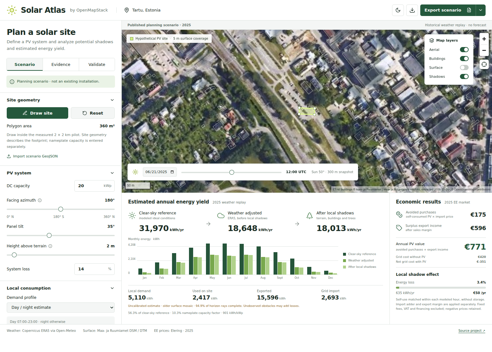
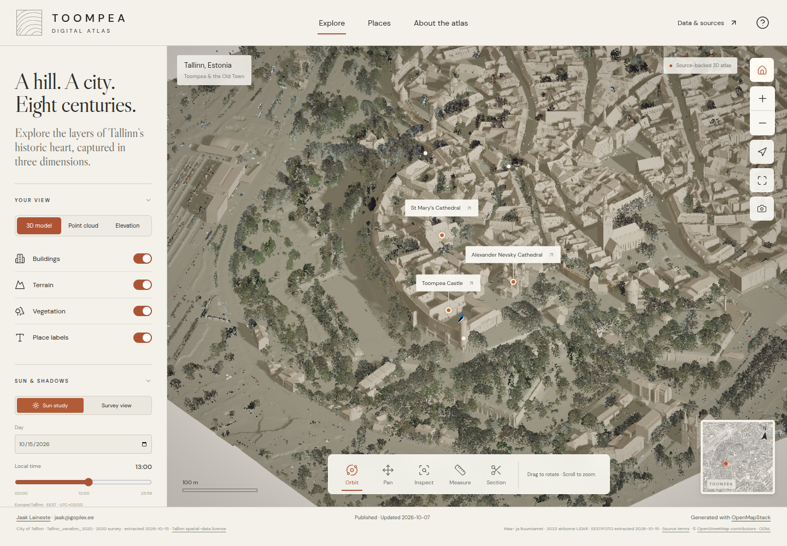
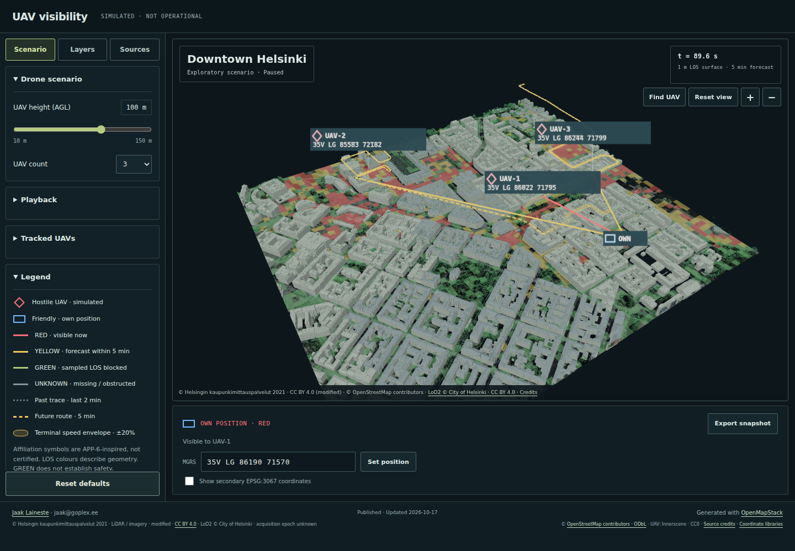
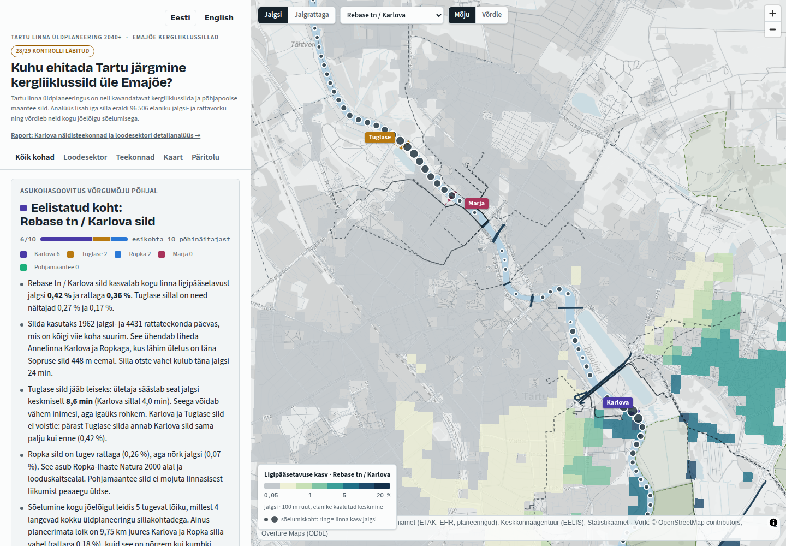
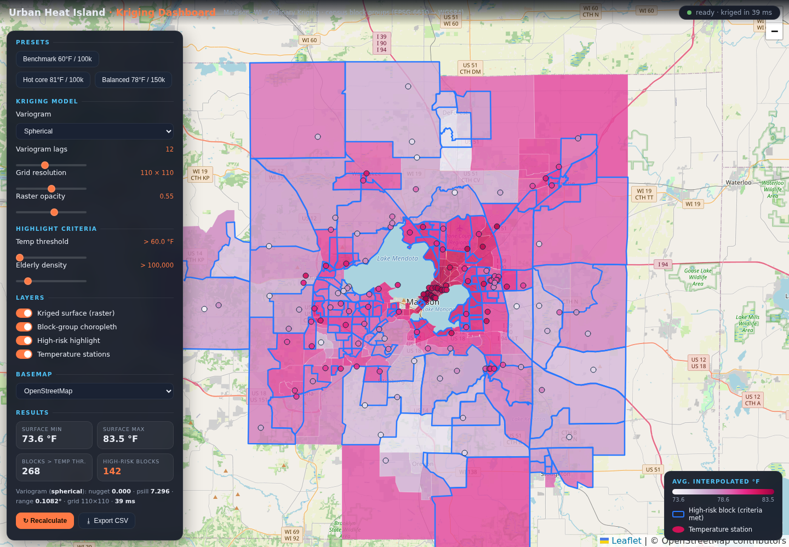

# OpenMapStack samples

Source-backed geospatial applications built with [OpenMapStack](https://github.com/jaakla/openmapstack-skills).

## Solar Atlas

Draw a hypothetical PV site in Tartu and compare clear-sky, weather-adjusted and locally shaded production. Add day/night consumption or an Enefit historical CSV to estimate on-site use, grid imports, surplus sales and value at 2024/2025 Estonian market prices. Export a three-page scenario PDF with maps, charts, assumptions and sources. Inspect official surface data and import your own 15-minute production CSV for comparison.

- [Open Solar Atlas](https://jaakla.github.io/openmapstack-samples/pv-location/)
- [Project documentation, reproducible pipeline and limitations](pv-location/README.md)
- [Example scenario PDF](pv-location/public/data/canonical-report.pdf)

This bounded planning prototype implements the core of [issue #4](https://github.com/jaakla/openmapstack-samples/issues/4). Regional aerial PV detection and owner field calibration remain pending.

## Toompea Digital Atlas

Explore surveyed architecture, airborne LiDAR, terrain, cross sections, measurements, and sun studies of Toompea hill in Tallinn.

- [Open the live atlas](https://jaakla.github.io/openmapstack-samples/toompea-3d/)
- [Project documentation and source evidence](toompea-3d/README.md)

## UAV visibility

Explore simulated hostile UAVs over downtown Helsinki using 2021 city LiDAR, including vegetation, and official LoD2 buildings. Live RED/YELLOW/GREEN line-of-sight zones for a 2 m observer, a five-minute forecast, and MGRS contact reports describe the simulated situation.

- [Open the live demo](https://jaakla.github.io/openmapstack-samples/battlefield-visibility/)
- [Project documentation and source evidence](battlefield-visibility/README.md)

### Tartu bridge analysis

Compare proposed Emajõgi crossings and their impact on walking and cycling accessibility.

### Urban Heat Island

Explore a kriged temperature surface, census block groups, model settings and heat-risk screening in Madison, Wisconsin.

## Publishing

The shared `Deploy GitHub Pages` workflow tests and builds all three demos on pull requests and pushes to `main`. Pushes to `main` publish the prepared browser assets under `pv-location/`, `toompea-3d/` and `battlefield-visibility/`; the [site root](https://jaakla.github.io/openmapstack-samples/) is a gallery linking these local demos and the external Cloudflare demos. Solar Atlas also runs browser interaction tests and rebuilds its canonical analysis and provenance from committed source snapshots.

Normal Pages builds use committed browser assets and skip raw Git LFS downloads. Toompea's original large LAZ survey files use Git LFS; full GIS recompilation requires `git lfs pull` and the numerical/desktop dependencies documented in that project. UAV visibility's raw acquisitions are excluded from normal git; its project documentation describes acquisition and full recompilation.

## Web analytics

Cloudflare Web Analytics is installed on the GitHub Pages gallery, Toompea atlas and UAV demo. All three use the `jaakla.github.io` site in the Cloudflare Web Analytics dashboard; filter by URL path to distinguish them. The beacon token in the HTML is a public tracking identifier, not an API credential. The separately hosted Cloudflare demos need their own snippets.
