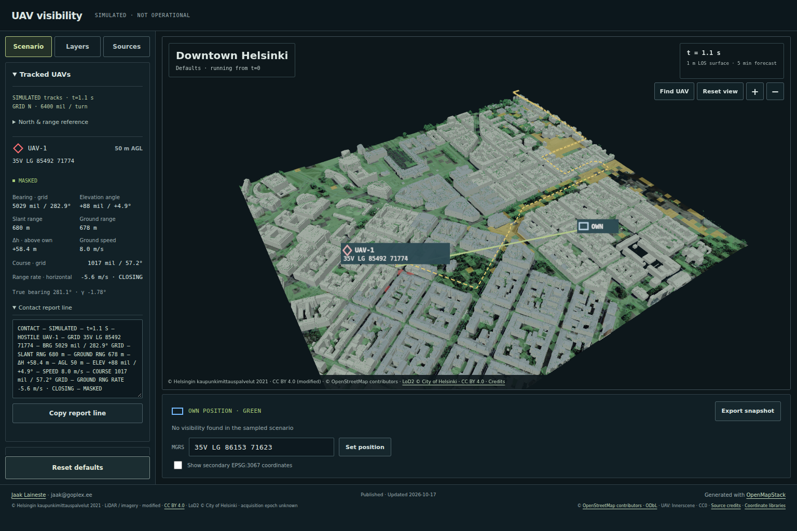
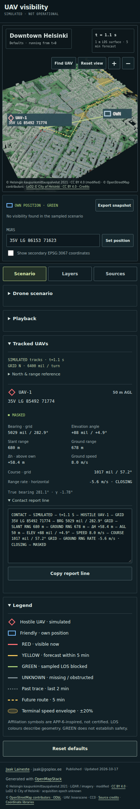
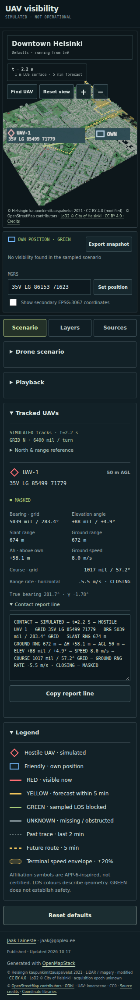

# Final owner tweaks: browser and frame-diff QA

The tested flow is load → automatic playback → inspect/copy contacts → hidden tab
and reduced-motion policy → canonical t=0 view/export → reset and resume → 0/3 UAVs.
Browser plugin not available; Playwright Chromium/SwiftShader was used. Temporary
profiles, downloads, screenshots, scripts and caches stayed in the worktree.

## Owner checklist

| Request | Result |
| --- | --- |
| UAV visibility name | Visible heading, HTML title, publication JSON, project/QGIS title, README heading and root gallery/link renamed; Downtown Helsinki remains AOI context |
| Accessible autoplay | Normal load and Reset defaults start at t=0; reduced-motion load/reset pause with a note; native preference changes pause; hidden tabs suspend clock and periodic requests |
| Canonical numbers | View published t=0 pauses/restores the canonical state; Export t=0 JSON downloads the byte-pinned snapshot independently of live playback |
| Stable rendering | Persistent scene objects/label textures and reusable buffers, deterministic transparent draw order, front-face/depth-biased zone overlay, no annotation depth writes, retained label offsets/pixel snapping, stable numeric layouts |
| Remove map hint | Removed from map and CSS; gestures live under Layers → Map help |
| Standard publication | Canonical project.publication, generated provenance, visible Vite footer, author/generator/date/status meta tags and project-metadata JSON; source credits/terms retained |

Publication metadata is dated **2026-10-17**, status **published**, author **Jaak
Laineste**, **jaak@goplex.ee**, generated with **OpenMapStack** at
<https://github.com/jaakla/openmapstack-skills>. Its HTML injection follows the
independent `toompea-3d/vite.config.js` pattern; there is no runtime dependency on
that demo. Published metadata does not deploy the application.

## Flicker investigation and measured evidence

Before the changes, a 40-sample playback probe found **3 COMPUTING / disabled-copy
samples** and **4 different zone-mesh and label identities**. Each periodic request
changed status text/colours and disabled controls; every response recreated meshes,
models and label canvases/textures. React card keys were already stable; extra
periodic busy-state renders and scene resource replacement were the main causes.

The fix retains the last complete displayed snapshot while a periodic request runs.
Selection changes still show COMPUTING until the requested result arrives. Scene
updates reuse keyed objects and same-size GPU buffers; only changed path topology
replaces geometry, disposing its old buffers. Label text updates reuse the canvas
texture and retain a valid placement offset; digit widths and control dimensions
are stable. No interpolation mixes report and LOS timestamps.

Playwright captured **14 full-page playback frames each at 390×844 and
1536×1024**, spanning **5 and 6 distinct worker snapshots**. It then reapplied the
same paused snapshot and captured **four frames per size**. Pillow/NumPy compared
RGB pixels. [Machine-readable results](final-frame-diff.json):

| Measurement | Phone | Desktop |
| --- | --- | --- |
| Zone / UAV / LOS / label / texture identities | Stable | Stable |
| Periodic COMPUTING or disabled-copy samples | 0 | 0 |
| Changed pixels in header, report disclosure and publication footer crops | 0 | 0 |
| Changed pixels across each repeated-identical-snapshot comparison | 0 / 0 / 0 | 0 / 0 / 0 |
| Maximum consecutive-frame change across the full page | 0.9723% | 0.7641% |

Nonzero playback differences are intended moving UAVs, MGRS/contact telemetry,
tracks and zone/status updates. Frames between updates are identical. This is
bounded Chromium evidence, not a claim about every browser or physical GPU.

## Production-path checks

URL: `http://127.0.0.1:5176/openmapstack-samples/battlefield-visibility/`.
Checked **320×700, 390×844 and 1536×1024**:

- Correct page identity, meaningful scene, no framework overlay, application
  exception, console warning/error or failed asset request.
- Playback advances automatically after load/reset; the default label explicitly
  says it runs from t=0. The first/reset worker request is exactly t=0.
- Native reduced-motion load/reset stays at t=0 with the note and Play available.
  Changing the media preference during playback pauses. Visibility-change tests
  drive document.hidden and confirm no hidden-time advance, then resume.
- View published t=0 reproduces the exact original contact line and downloaded
  counts **`[2408,1288,198,6]`**. Live and canonical exports remain separate.
- Zero UAVs then three UAVs at 150m AGL render correctly; Reset view fits them.
- No horizontal overflow. The publication footer is visible within the desktop
  viewport at y=934, height=90px, and below the stacked phone workspace.
- Built JSON metadata equals canonical provenance; author/generator tags and
  visible footer match it, with working nested-base source-credit links.

## Validation

Canonical run **`run-20261017-163552`** and standalone strict validation:
**81 CLI checks passed**, zero warnings/not-testable/failures. All **25 domain
checks** pass, including added `publication_contract`; previous checks remain.
**40 JavaScript + 8 Python tests** pass, including autoplay/hidden-clock,
publication escaping/JSON, retained line buffers and resized-geometry disposal.
All **24 output hashes** verify; inventory **74 inputs / 24 outputs**.
Production build passes. Public data/models total **14,825,791 bytes**.
Source locks, LiDAR/LoD2 geometry, visibility rules and canonical t=0 numbers are
unchanged. Physical Android/iOS GPU performance and Safari remain unmeasured.

## Screenshots

Screenshots show normal automatic playback from published defaults, not the static
t=0 result. Contact reports are expanded, scenario/playback controls collapsed;
the desktop sidebar is scrolled to show the report and the visible publication
footer. Capture times are shown in the UI.

