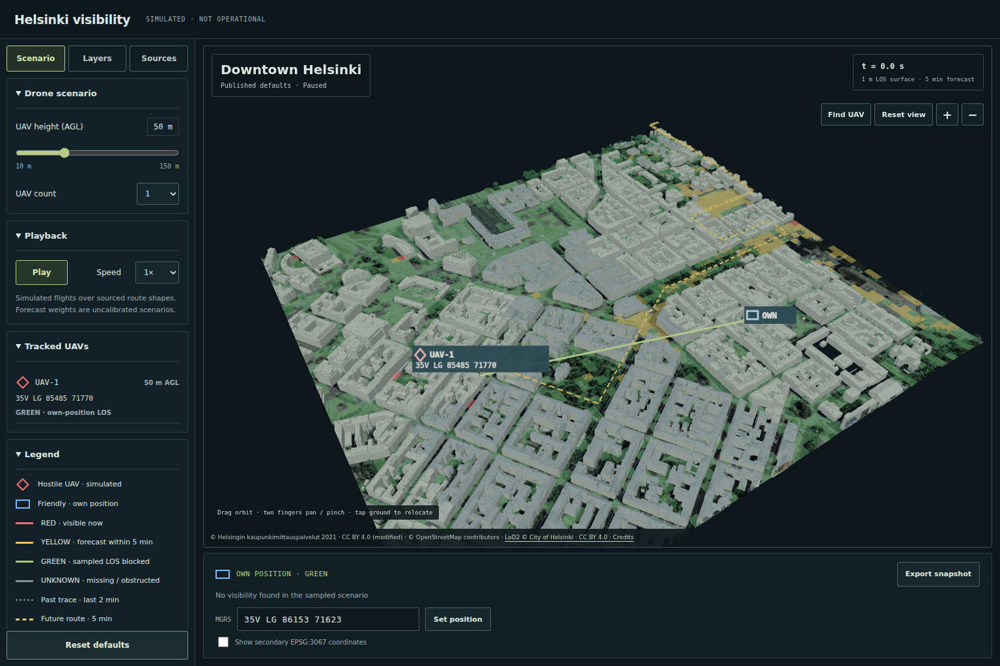
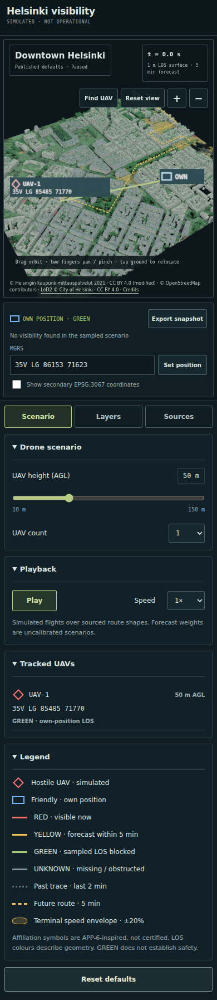
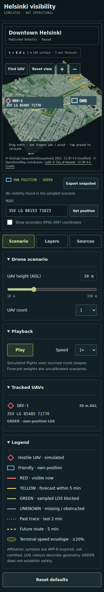
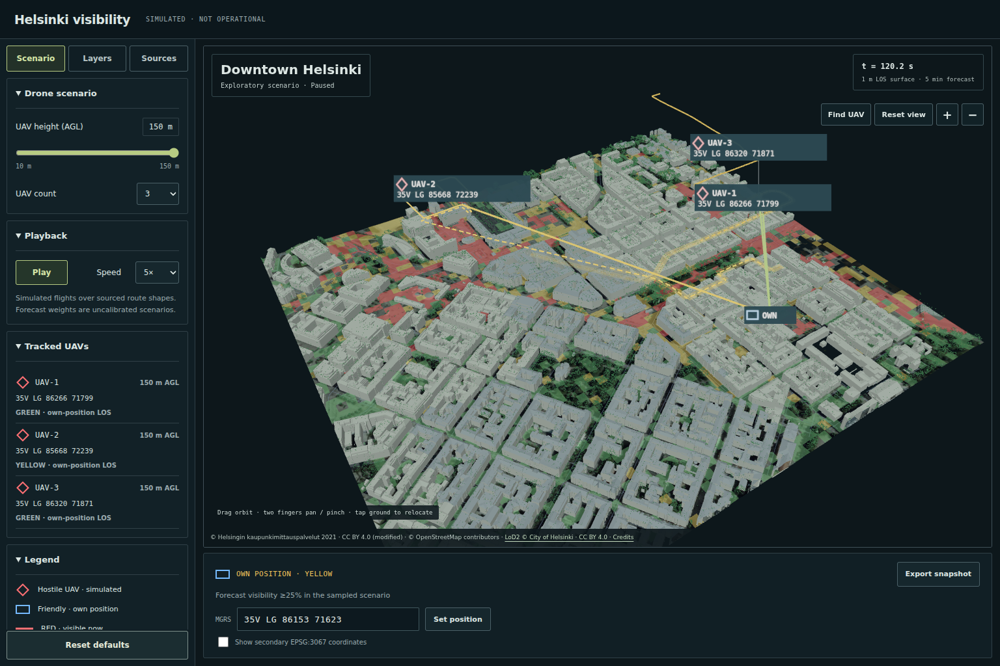

# Iteration 2 browser and visual QA

The flow under test was load → source-backed 3D scene → MGRS relocation and export
→ individual UAV LOS → count/height/playback → layer groups → exact default reset.

Browser plugin not available; regular Playwright Chromium was used. Development
checks ran at `http://127.0.0.1:5175/`; production checks ran at
`http://127.0.0.1:5176/openmapstack-samples/battlefield-visibility/`.
Viewports: desktop **1536×1024**, touch **390×844**, and narrow **320×700**.
The headless renderer used SwiftShader; this is not a physical-phone benchmark.
Temporary profiles, downloads, scripts and caches stayed under the worktree.

| Check | Result |
| --- | --- |
| Page identity / meaningful content | Pass: Helsinki title, measured terrain, official LoD2 roofs, vegetation and licensed UAV model |
| Framework overlays / console / assets | Pass: no overlays, console errors/warnings or HTTP asset failures; GLB and worker loaded |
| Individual LOS | Pass: all four statuses at MGRS-selected measured positions; rendered endpoints match drone altitude and own position at 2 m AGL |
| MGRS controls / export | Pass: valid entry, rejected invalid input without moving target, optional EPSG:3067 display, downloaded JSON with MGRS own/drone locations |
| Playback / tracks | Pass: 0–3 UAVs, AGL change to 150 m, 5× playback, dotted elapsed history, nine future hypotheses and three terminal envelopes |
| Layer controls / provenance | Pass: individual and group switches mark the view exploratory; reset restores the published label; official LoD2 inventory and source/licence details accessible |
| Canonical reset | Pass: t=0, manifest defaults/layers/target, secondary display off; exact zone counts `[2408,1288,198,6]` restored |
| Responsive layout | Pass: no horizontal overflow or title/snapshot/toolbar/readout overlaps at all three viewports |
| Initial/reset camera | Pass after QA follow-up: OWN and every active UAV fit with padding at all three sizes; full OWN and UAV labels are visible |

## Camera-framing follow-up

QA found that the original fixed camera distance put OWN at x=307.37 on a
306px canvas. The aspect-aware fit now reserves 56px horizontally for OWN
(40px half-label plus 16px clearance), 36px for UAV anchors, and vertical
clearance for overlays. It includes perspective depth and measured UAV altitude.
The original desktop position and viewing direction are preserved when they fit.

Playwright checked **20 states**: initial load, zoom → Reset view, three UAVs at
150m AGL → Reset view, zero UAVs → Reset view, relocated own position → Find UAV
→ Reset view, and Reset defaults from that exploratory snapshot at each size;
also desktop → 320px → desktop resizing. The final default fit waits for the new
worker result. Camera fitting stops following resize after manual orbit/zoom/focus
until Reset view. No browser exceptions, console warnings/errors, failed assets,
horizontal overflow or clipped UAV labels occurred in these checks.

| Page viewport | Actual canvas | Default OWN centre in canvas | Full OWN right edge / clearance |
| --- | --- | --- | --- |
| 320×700 | 306×448 | (250.00, 234.39) | 290px / 16px |
| 390×844 | 376×463 | (320.00, 245.64) | 360px / 16px |
| 1536×1024 | 1210×770 | (870.32, 413.43) | 910.32px / 299.68px |

All sensor anchors also passed their padding and near/far-plane assertions.
The three new Node camera tests reproduce the original 320px failure and cover
all AOI corners, zero through three active UAVs, maximum configured altitude,
near-camera perspective depth and unchanged desktop framing. They run with the
existing LOS/product suite through `npm test` and the canonical pipeline.

Canonical follow-up run **`run-20261017-144455`** and standalone strict validation:
**81 passed**, zero warnings/not-testable/failures. **27 JavaScript + 8 Python
tests** pass; all **24 output hashes** verify. Published zone counts remain
`[2408,1288,198,6]`. Production build and nested Pages-base browser checks pass;
the refreshed screenshots below use this run and published t=0 defaults.

Road edges are batched into one draw call. Before label leaders, the default scene
used 67 draw calls versus roughly 3,000 before batching. Source edges and measured
surfaces are unchanged. This improves rendering cost but does not establish an
FPS target on untested hardware.

## Visual comparison

The generated design reference and rendered screenshots were inspected with
`view_image`. The implemented design follows the reference's dark console palette,
monospace telemetry, tab/collapsible hierarchy, map-first mobile stacking and
restrained borders. Final screenshots were inspected again after the changes.

| Comparison | Verified treatment |
| --- | --- |
| Copy / semantics | Required title, simulation label, UAV controls and MGRS; corrected concept legend to RED = visible |
| Layout | Sidebar on desktop; map/readout first on phone; controls clear at 320px |
| Typography | Deliberate control sizes and monospace coordinate/telemetry readouts |
| Palette / symbols | Dark blue-green surfaces, olive controls, hostile red diamond and friendly blue frame; status colour independent of affiliation |
| Asset treatment | Real untextured LoD2 roofs and pinned 2021 imagery replace the concept's illustrative textured city; no generated geometry or map image used |
| Dense state | Screen-sized UAV labels use leader lines and avoid each other; past/future strokes and terminal envelope remain distinct |

Intentional differences from the visual concept are driven by the published
10–150 m range, accurate visibility semantics, source-backed untextured buildings,
and working MGRS entry/export. The design was checked against these requirements;
no unresolved functional or responsive finding remains in the tested Chromium
views. Physical Android/iOS GPU performance and Safari remain unmeasured.

## Screenshots

Published defaults, desktop:

Published defaults, 390px phone (full page):

Published defaults, 320px phone (full page), after the camera-framing fix:

Exploratory playback paused near t=120 s: three UAVs at 150 m AGL, 5× playback
speed selected. This is not the published t=0 state.

