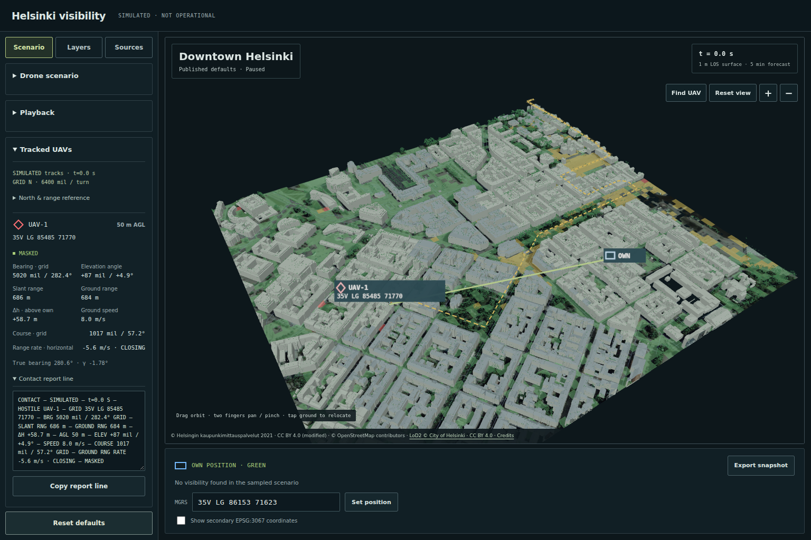
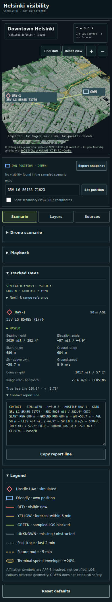
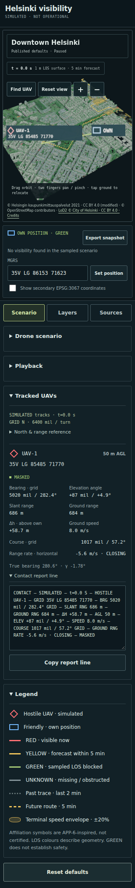

# Iteration 3: relative UAV contact reports

The tested flow is load → Tracked UAVs → inspect/copy report → relocate OWN /
change AGL and UAV count → play/pause → exact default reset.

Browser plugin not available; regular Playwright Chromium/SwiftShader was used.
Development URL: `http://127.0.0.1:5175/`. Production URL:
`http://127.0.0.1:5176/openmapstack-samples/battlefield-visibility/`.
Page viewports: **320×700, 390×844 and 1536×1024**. Phone cases use touch emulation.
All temporary scripts, profiles, downloads and caches stayed in the worktree.

## Acceptance and numerical checks

| Owner requirement | Result |
| --- | --- |
| Pure calculations | `src/contact.js`: deterministic local-grid calculations and formatting; eight analytic/integration tests |
| Bearing / azimuth | Clockwise grid north, degrees and 6400-turn mils; card also shows local true bearing and signed convergence at OWN |
| Ranges | Horizontal projected-grid and 3D slant; m below 1km / km from 1km |
| Relative height / AGL | Signed UAV N2000 minus OWN DTM+2m, plus UAV AGL at its own terrain sample |
| Elevation | Signed degrees and mils; overhead/coincident undefined bearings handled |
| Speed / course | Scenario speed and outgoing source-route segment, including corners/reversals; course is grid referenced |
| Closing / opening | Signed horizontal range derivative with stationary own position; negative closing / positive opening |
| LOS / MGRS | Individual UAV classifications and MGRS from the same worker snapshot as the scene |
| Radio-style line | Expandable, selectable, copyable; simulation time and SIMULATED label included |
| Live / compact UI | All three sizes, playback, relocation, 0/3 UAVs, AGL changes and reset checked |
| Optional closest approach | Not included; optional in the owner's request |

Independent PROJ references cover γ west/east of the central meridian and γ=0
on it. Default OWN has **γ=−1.7798528359°**. The default UAV contact is:
grid **282.3802668° / 5020.0936 mil**, local true **280.6004140°**;
ground **683.8548m**, slant **686.3695m**, Δh **+58.7m**, AGL **50m**;
elevation **+4.9061° / +87.2190 mil**; speed **8m/s**, course
**57.2187° / 1017.2221 mil**; ground range rate **−5.6409m/s**, MASKED.
Displayed values are rounded; report fields use the same formatting as the card.

North and rate semantics are visible through **North & range reference** and
documented in README/project assumptions. True bearing is the local orientation
of the grid chord, not an ellipsoidal geodesic azimuth. No magnetic declination,
own heading, clock directions or vertical velocity are inferred.

## Browser checks

| Check | Result |
| --- | --- |
| Identity / meaningful content / framework overlay | Correct Helsinki title, source-backed 3D scene and contact rows; no overlay |
| Console / assets | No application exceptions, warnings/errors or failed HTTP assets |
| Numeric/UI consistency | 27 development checkpoints: fields/report agree with live worker time, MGRS and per-UAV LOS |
| All four LOS states | UNKNOWN / MASKED / LIKELY VISIBLE ≤5 MIN / VISIBLE NOW checked at known MGRS targets |
| Copy | Clipboard text equals the complete report exactly |
| Clipboard unavailable/denied | Report text is selected in full and manual-copy feedback appears |
| Playback | Time, bearings/ranges/course/rate/report update; 5× playback still reports physical scenario speed of 8m/s |
| Reset | Restores the exact t=0 report, target, 50m AGL and one UAV |
| Responsive | No horizontal document overflow or clipped card labels/values at any tested size |

The final production-path pass compares every displayed numeric field with the
canonical contact, exercises clipboard success/failure, playback and exact reset
at all three sizes. Screenshots were inspected for framing, clipping, typography
and overlay collisions. The earlier aspect-aware camera fix remains intact.

## Canonical validation

Run **`run-20261017-150924`**: **81 CLI checks pass**, zero warnings/not-testable/
failures. The report has **24 domain checks**, including the added
`relative_contact_reports`; all 23 previous checks remain. **35 JavaScript +
8 Python tests** pass; standalone strict validation and **24 output hashes** pass.
Inventory: **70 inputs / 24 outputs**. Production Pages-base build passes.
Public data/models: **14,825,394 bytes**. Published zone counts remain
`[2408,1288,198,6]`; LiDAR, official building geometry and source locks are unchanged.

Physical Android/iOS GPU performance and Safari remain unmeasured. These reports
describe geometric simulation and uncalibrated forecasts, not observed contacts
or certified military messaging.

## Screenshots

Published analytical defaults at t=0; Drone scenario and Playback sections are
collapsed and the contact report is expanded to expose the new UI.

