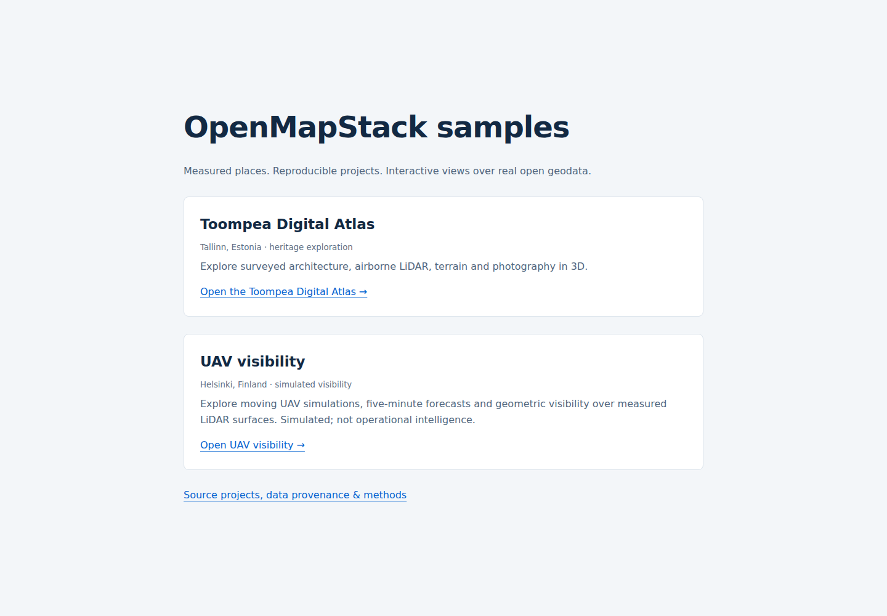
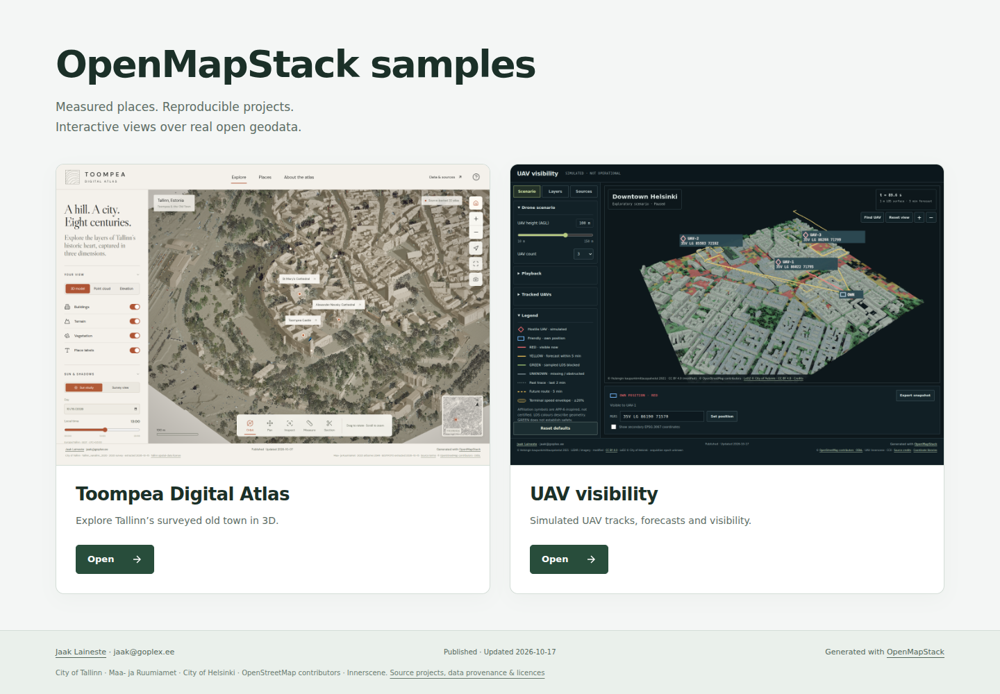
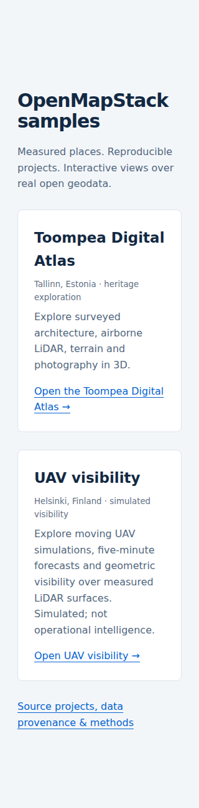
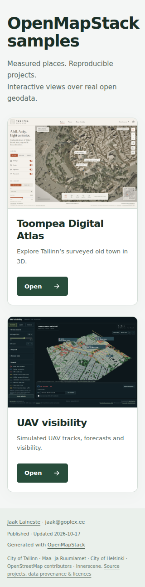

# Gallery and UAV preview review

The flow under test was assembled Pages gallery → both real preview images → Open
Toompea / Open UAV visibility → the production demo URL. Browser plugin not
available; Playwright Chromium was used. Preview rendering used SwiftShader.
All temporary files and browser profiles stayed in the worktree.

## UAV hero source

`battlefield-visibility/docs/uav-visibility-preview.png` is an **unedited production
build screenshot**, **1440×1000**, **702,825 bytes** (0.703 MB), matching the existing
Toompea preview's dimensions. No generated imagery, synthetic baseline geometry,
post-capture image compositing or application code changes were used.

It shows an exploratory **SIMULATED** scenario, paused mid-playback at **t=89.58 s**:
three UAVs at **100 m AGL**, OWN at **35V LG 86190 71570**, and the published
perspective camera after Reset view. One UAV has current visibility (RED LOS),
two have sampled forecast visibility (YELLOW LOS). The image includes measured
LiDAR/vegetation, official LoD2 roofs, RED/YELLOW zones, faint dotted elapsed
history, dashed five-minute forecasts, uncertainty, tactical controls and legend.

[Capture evidence](../battlefield-visibility/docs/uav-visibility-preview.json)
records the image SHA-256, exact scenario time/settings, zone counts and per-UAV
states. Recalculation with the unchanged shipped inputs reproduced every UAV MGRS
position and LOS state: **336 RED**, **374 YELLOW**, **800 GREEN**, **2390 UNKNOWN**
cells; all three history paths contain multiple source vertices. The preview is
an exploratory view, not the published t=0 snapshot or an observed contact report.

## Gallery and Pages delivery

- Two peer cards have a title, one-sentence description, real linked preview and
  accessible Open link. Both READMEs use the dedicated UAV hero, linked to its live URL.
- Root HTML is self-contained: system fonts, inline CSS/SVG and **two local PNGs**.
  Gallery load makes exactly **three local requests** (HTML + previews), with
  **zero external asset requests**, JavaScript dependencies or remote fonts.
- `.github/workflows/pages.yml` copies both source previews into `_site/gallery/`
  alongside both built demos. The gallery uses relative `./gallery/…` URLs.
- Local `_site` was assembled with the same commands as the workflow, then served
  at `http://127.0.0.1:5180/openmapstack-samples/` to preserve the production base.
- OpenMapStack author/generator/date/status metadata, JSON and visible attribution
  footer match the project's existing publication convention; source evidence is linked.

## Browser checks and visual review

| Check | 1440×1000 | 320×800 |
| --- | --- | --- |
| Correct identity / meaningful content | Pass | Pass |
| Both 1440×1000 preview files loaded | Pass | Pass |
| Card arrangement | Two equal columns | One stacked column |
| Horizontal overflow / clipped controls | None | None |
| Console warnings/errors / failed gallery assets | None | None |
| External gallery requests | Zero | Zero |
| Both Open links navigate to correct production demo title/base | Pass | Pass |
| Visible attribution / matching JSON | Pass | Pass |

The original Toompea reference, UAV capture and latest gallery screenshots were
inspected with `view_image`. Review covered copy, typography, spacing, card/image
framing, matching aspect ratio, palette, responsive wrapping, footer and link
contrast. Both previews remain uncropped; compact mobile text wraps naturally.
The gallery's light neutral/green styling gives the cream Toompea and dark UAV
screens equal prominence without modifying either image or demo behavior.

Both production builds and all **40 UAV + 11 Toompea JavaScript tests** pass.
UAV strict validation remains **81 passed**; all **24 output hashes** verify.
All changed files are outside the **74 canonical GIS inputs**; no pipeline outputs
or run records were regenerated. Demo source, defaults and analysis are unchanged.
Physical-device/browser performance beyond Chromium was not measured.

## Before / after

Desktop before:

Desktop after:

320px before:

320px after:

